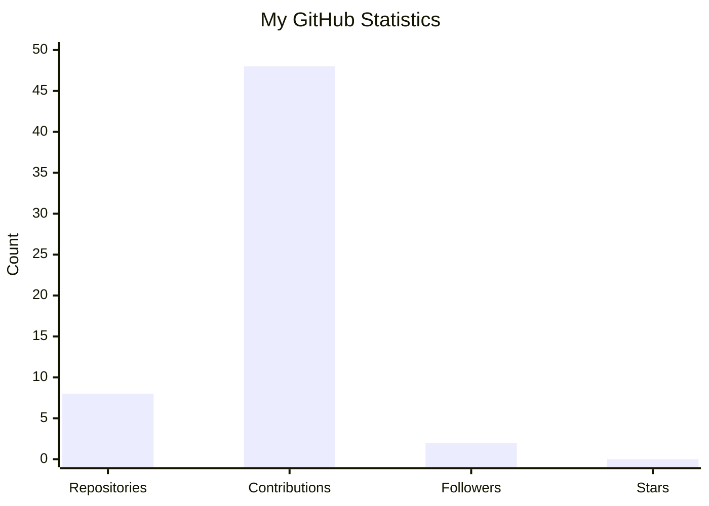

# 👋 Hi, I'm Khushi Sannikop

### 🎓 B.Tech Artificial Intelligence & Machine Learning Student

I'm an AIML student interested in **Artificial Intelligence, Machine Learning, Python, Data Analytics and Web Development**.

---

## 👩‍💻 About Me

* 🎓 B.Tech – Artificial Intelligence & Machine Learning
* 🐍 Learning Python
* ☕ Learning Java
* 💻 C Programming
* 🤖 Interested in AI & Machine Learning
* 📊 Interested in Data Analytics
* 🌐 Building websites and beginner-friendly projects
* 🚀 Exploring new technologies and development tools

---

## 📊 GitHub Statistics

| 📁 Repositories | 🔥 Contributions | 👥 Followers | ⭐ Stars |
| --------------: | ---------------: | -----------: | ------: |
|           **9** |           **55** |        **2** |   **0** |

### 📈 My GitHub Activity

---

## 🛠️ Skills

**Programming:**
C • Java • Python

**Areas of Interest:**
AI • Machine Learning • Data Analytics • Web Development

**Tools:**
Git • GitHub • VS Code

---

## 🚀 Projects

* 🌾 **AgriRent** – Agricultural rental machine website
* 📰 **Fake News Detection** – Machine-learning-based project
* 💼 **Portfolio Generator** – Personal portfolio website
* 🌱 **Soil Suitability** – Website for soil and crop-related information
* 👤 **Face Detection** – Computer vision project

---

## 📚 Currently Learning

* Java
* Data Structures & Algorithms
* Artificial Intelligence
* Machine Learning
* Database Management Systems
* Git & GitHub

---
## 📫 Connect With Me at github|linkedin

Feel free to explore my repositories and follow my learning journey!

⭐ Thanks for visiting my profile!
